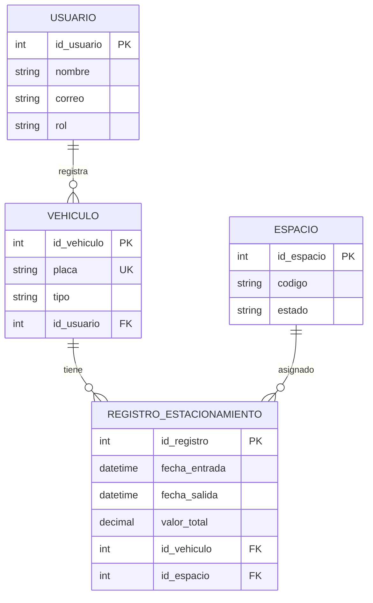

#  ZonaPark — Sistema Inteligente de Gestión y Administración de Parqueaderos

##  Descripción del proyecto

ZonaPark es un sistema web diseñado para facilitar la gestión y administración de parqueaderos. Permite registrar vehículos, controlar los espacios disponibles y ocupados, registrar entradas y salidas, calcular el tiempo de estacionamiento y determinar el valor a pagar.

El proyecto busca reducir los errores de los registros manuales, agilizar la atención y mejorar el control de la información del parqueadero.

Está dirigido a administradores, empleados y clientes. Entre las funcionalidades contempladas se encuentran la autenticación de usuarios, la gestión de vehículos y espacios, el cálculo de tarifas, el historial de estacionamiento y la generación de reportes.

##  Video de presentación

Link: https://www.youtube.com/watch?v=WLEybjnGAeM

## 👥 Equipo de desarrollo

| Integrante | Rol inicial | GitHub |
|---|---|---|
| Oscar Jairo Álvarez López | Base de datos | [@OscarAlvarez28](https://github.com/OscarAlvarez28) |
| Esteban Forero Deossa | Líder / Coordinación | [@foreroesteban93-cell](https://github.com/foreroesteban93-cell) |
| Mateo Vargas Martínez | Frontend | [@mateovm345-netize](https://github.com/mateovm345-netize) |
| Adrián Alejandro Velázquez Petro | Backend / API | [@adrianvp423-bot](https://github.com/adrianvp423-bot) |

Los roles corresponden a la distribución inicial propuesta en la documentación del proyecto.

## 🎯 Hito 1: Elevator Pitch

### ¿Qué es?

ZonaPark es un sistema web que permite administrar las operaciones de un parqueadero mediante el registro de vehículos, el control de espacios y el cálculo del tiempo de estacionamiento y su cobro.

### ¿Para quién es?

Está dirigido a administradores y empleados de parqueaderos, así como a clientes que necesitan consultar su historial de pagos y el tiempo de estacionamiento de sus vehículos.

### ¿Qué problema resuelve?

Busca reducir los errores en el registro de vehículos y en el cálculo de tarifas, disminuir las demoras en la atención y mejorar el control de los espacios disponibles y ocupados, evitando depender de cuadernos u hojas de cálculo.

### Entidades principales

- **Usuario:** representa a los administradores, empleados y clientes del sistema.
- **Vehículo:** almacena información como la placa y el tipo de vehículo.
- **Espacio:** representa los espacios del parqueadero y su estado.
- **RegistroEstacionamiento:** almacena la información de entrada, salida y valor del estacionamiento.

## 🗃️ Hito 2: Diagrama Entidad-Relación

El modelo inicial contiene cuatro entidades principales y sus relaciones.

### Relaciones principales

- Un usuario puede registrar varios vehículos.
- Un vehículo puede tener varios registros de estacionamiento.
- Un espacio puede estar asociado a varios registros a lo largo del tiempo.

## 🔌 Hito 3: Diseño de Endpoints REST

La API de ZonaPark utilizará el prefijo `/api/v1` y seguirá las buenas prácticas REST, utilizando sustantivos, nombres plurales y métodos HTTP según la operación.

### 1. Endpoints de Usuarios

| Método | Endpoint | Descripción | Payload (Body) | Respuesta |
|---|---|---|---|---|
| GET | `/api/v1/usuarios` | Listar usuarios | N/A | 200 OK |
| GET | `/api/v1/usuarios/{id}` | Consultar un usuario | N/A | 200 OK |
| POST | `/api/v1/usuarios` | Crear un usuario | `{"nombre":"Carlos Pérez","correo":"carlos@gmail.com","rol":"cliente"}` | 201 Created |
| PATCH | `/api/v1/usuarios/{id}` | Actualizar datos del usuario | `{"nombre":"Carlos Gómez"}` | 200 OK |
| DELETE | `/api/v1/usuarios/{id}` | Eliminar un usuario si está permitido | N/A | 204 No Content |

### 2. Endpoints de Vehículos

| Método | Endpoint | Descripción | Payload (Body) | Respuesta |
|---|---|---|---|---|
| GET | `/api/v1/vehiculos` | Listar vehículos | N/A | 200 OK |
| GET | `/api/v1/vehiculos/{id}` | Consultar un vehículo | N/A | 200 OK |
| POST | `/api/v1/vehiculos` | Registrar un vehículo asociado a un usuario | `{"placa":"ABC123","tipo":"carro","id_usuario":1}` | 201 Created |
| PATCH | `/api/v1/vehiculos/{id}` | Actualizar datos del vehículo | `{"tipo":"motocicleta"}` | 200 OK |
| DELETE | `/api/v1/vehiculos/{id}` | Eliminar un vehículo si está permitido | N/A | 204 No Content |
| GET | `/api/v1/usuarios/{id}/vehiculos` | Consultar vehículos de un usuario | N/A | 200 OK |

### 3. Endpoints de Espacios

| Método | Endpoint | Descripción | Payload (Body) | Respuesta |
|---|---|---|---|---|
| GET | `/api/v1/espacios` | Listar espacios del parqueadero | N/A | 200 OK |
| GET | `/api/v1/espacios/{id}` | Consultar un espacio | N/A | 200 OK |
| POST | `/api/v1/espacios` | Crear un espacio | `{"codigo":"A01","estado":"disponible"}` | 201 Created |
| PATCH | `/api/v1/espacios/{id}` | Actualizar información del espacio | `{"codigo":"A02"}` | 200 OK |
| DELETE | `/api/v1/espacios/{id}` | Eliminar un espacio si no tiene registros que lo impidan | N/A | 204 No Content |
| GET | `/api/v1/espacios/{id}/registros-estacionamiento` | Consultar registros asociados a un espacio | N/A | 200 OK |

### 4. Endpoints de Registros de Estacionamiento

| Método | Endpoint | Descripción | Payload (Body) | Respuesta |
|---|---|---|---|---|
| GET | `/api/v1/registros-estacionamiento` | Listar registros de estacionamiento | N/A | 200 OK |
| GET | `/api/v1/registros-estacionamiento/{id}` | Consultar un registro específico | N/A | 200 OK |
| POST | `/api/v1/registros-estacionamiento` | Registrar la entrada de un vehículo y asignar un espacio | `{"id_vehiculo":1,"id_espacio":2,"fecha_entrada":"2026-10-16T08:00:00"}` | 201 Created |
| PATCH | `/api/v1/registros-estacionamiento/{id}` | Registrar la salida y calcular el cobro | `{"fecha_salida":"2026-10-16T10:30:00"}` | 200 OK |
| DELETE | `/api/v1/registros-estacionamiento/{id}` | Eliminar un registro si las reglas lo permiten | N/A | 204 No Content |
| GET | `/api/v1/vehiculos/{id}/registros-estacionamiento` | Consultar el historial de estacionamiento de un vehículo | N/A | 200 OK |

### Métodos HTTP y respuestas

- **GET:** consulta información.
- **POST:** crea un registro.
- **PATCH:** actualiza parcialmente un registro.
- **DELETE:** elimina un registro cuando las reglas lo permiten.
- **200 OK:** operación realizada correctamente.
- **201 Created:** recurso creado.
- **204 No Content:** operación realizada sin contenido de respuesta.

Los códigos y payloads representan el diseño propuesto de los endpoints; deberán verificarse durante la implementación y las pruebas.

## 🛠️ Stack tecnológico propuesto

| Componente | Tecnología | Uso |
|---|---|---|
| Backend | C# y ASP.NET Core | Lógica de negocio y API REST |
| Acceso a datos | Entity Framework Core | Acceso y operaciones con la base de datos |
| Base de datos | MySQL | Almacenamiento de usuarios, vehículos, espacios y registros |
| Frontend | HTML5, CSS3 y JavaScript | Interfaz de usuario |
| Framework de interfaz | Bootstrap | Diseño responsive |
| Documentación de API | Swagger | Documentación y consulta de endpoints |
| Pruebas de API | Postman | Pruebas de solicitudes y respuestas HTTP |
| Control de versiones | Git y GitHub | Gestión del código fuente y trabajo en equipo |
| Despliegue previsto | Render o Railway | Opciones consideradas para publicar el sistema |

Las tecnologías y herramientas anteriores corresponden a la propuesta documentada del proyecto; no implican que todos los componentes estén implementados actualmente.

##  Roadmap / Próximos pasos

1. Configurar el entorno de desarrollo.
2. Definir e implementar el modelo de datos en MySQL.
3. Desarrollar la API REST con ASP.NET Core.
4. Implementar los módulos de autenticación, gestión de vehículos y espacios, y cálculo de tiempo y cobro.
5. Desarrollar la interfaz web responsive.
6. Documentar y probar los endpoints con Swagger y Postman.
7. Verificar la autenticación, los roles, el rate limiting y el cálculo de tarifas.
8. Preparar las evidencias de pruebas y la presentación final.

##  Enlaces del proyecto

- **Repositorio GitHub:** [ZonaPark](https://github.com/foreroesteban93-cell/zona-park-fastapi)
- **Video de presentación:** (YouTube) (https://www.youtube.com/watch?v=WLEybjnGAeM)

---

**Proyecto formativo ADSO-CTMA**

