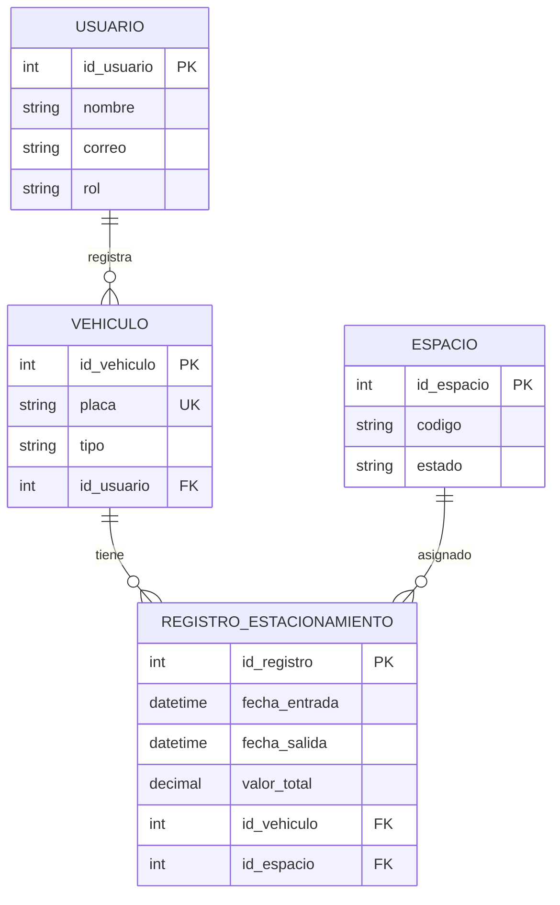

Hito 1: Elevator Pitch — ZonaPark
Proyecto: ZonaPark — Sistema Inteligente de Gestión y Administración de Parqueaderos.
¿Qué es?
Es un sistema web que permite administrar las operaciones de un parqueadero, facilitando el registro de vehículos, el control de espacios disponibles y ocupados, y el cálculo automático del tiempo de estacionamiento y su cobro.
¿Para quién es?
Está dirigido a los administradores y empleados de parqueaderos, así como a los clientes que necesitan consultar su historial de pagos y el tiempo que sus vehículos estuvieron estacionados.
¿Qué problema resuelve?
Busca reducir los errores en el registro de vehículos y el cálculo de tarifas, disminuir las demoras en la atención y mejorar el control de los espacios, evitando depender de registros manuales en cuadernos u hojas de cálculo.

Hito 2 # Diagrama Entidad-Relación - ZonaPark

## Hito 3: Diseño de Endpoints REST

La API de ZonaPark utilizará el prefijo `/api/v1` y seguirá las buenas prácticas REST, utilizando sustantivos, nombres plurales, rutas con kebab-case y métodos HTTP según la operación.

### 1. Endpoints de Usuarios

| Método | Endpoint | Descripción | Payload (Body) | Respuesta |
|---|---|---|---|---|
| GET | `/api/v1/usuarios` | Listar usuarios | N/A | 200 OK |
| GET | `/api/v1/usuarios/{id}` | Consultar un usuario | N/A | 200 OK |
| POST | `/api/v1/usuarios` | Crear un usuario | `{"nombre":"Carlos Pérez","correo":"carlos@gmail.com","rol":"cliente"}` | 201 Created |
| PATCH | `/api/v1/usuarios/{id}` | Actualizar datos del usuario | `{"nombre":"Carlos Gómez"}` | 200 OK |
| DELETE | `/api/v1/usuarios/{id}` | Eliminar un usuario si está permitido | N/A | 204 No Content |

### 2. Endpoints de Vehículos

| Método | Endpoint | Descripción | Payload (Body) | Respuesta |
|---|---|---|---|---|
| GET | `/api/v1/vehiculos` | Listar vehículos | N/A | 200 OK |
| GET | `/api/v1/vehiculos/{id}` | Consultar un vehículo | N/A | 200 OK |
| POST | `/api/v1/vehiculos` | Registrar un vehículo asociado a un usuario | `{"placa":"ABC123","tipo":"carro","id_usuario":1}` | 201 Created |
| PATCH | `/api/v1/vehiculos/{id}` | Actualizar datos del vehículo | `{"tipo":"motocicleta"}` | 200 OK |
| DELETE | `/api/v1/vehiculos/{id}` | Eliminar un vehículo si está permitido | N/A | 204 No Content |
| GET | `/api/v1/usuarios/{id}/vehiculos` | Consultar vehículos de un usuario | N/A | 200 OK |

### 3. Endpoints de Espacios

| Método | Endpoint | Descripción | Payload (Body) | Respuesta |
|---|---|---|---|---|
| GET | `/api/v1/espacios` | Listar espacios del parqueadero | N/A | 200 OK |
| GET | `/api/v1/espacios/{id}` | Consultar un espacio | N/A | 200 OK |
| POST | `/api/v1/espacios` | Crear un espacio | `{"codigo":"A01","estado":"disponible"}` | 201 Created |
| PATCH | `/api/v1/espacios/{id}` | Actualizar información del espacio | `{"codigo":"A02"}` | 200 OK |
| DELETE | `/api/v1/espacios/{id}` | Eliminar un espacio si no tiene registros que lo impidan | N/A | 204 No Content |
| GET | `/api/v1/espacios/{id}/registros-estacionamiento` | Consultar registros asociados a un espacio | N/A | 200 OK |

### 4. Endpoints de Registros de Estacionamiento

| Método | Endpoint | Descripción | Payload (Body) | Respuesta |
|---|---|---|---|---|
| GET | `/api/v1/registros-estacionamiento` | Listar registros de estacionamiento | N/A | 200 OK |
| GET | `/api/v1/registros-estacionamiento/{id}` | Consultar un registro específico | N/A | 200 OK |
| POST | `/api/v1/registros-estacionamiento` | Registrar la entrada de un vehículo y asignar un espacio | `{"id_vehiculo":1,"id_espacio":2,"fecha_entrada":"2026-10-16T08:00:00"}` | 201 Created |
| PATCH | `/api/v1/registros-estacionamiento/{id}` | Registrar la salida y calcular el cobro | `{"fecha_salida":"2026-10-16T10:30:00"}` | 200 OK |
| DELETE | `/api/v1/registros-estacionamiento/{id}` | Eliminar un registro si las reglas lo permiten | N/A | 204 No Content |
| GET | `/api/v1/vehiculos/{id}/registros-estacionamiento` | Consultar el historial de estacionamiento de un vehículo | N/A | 200 OK |
